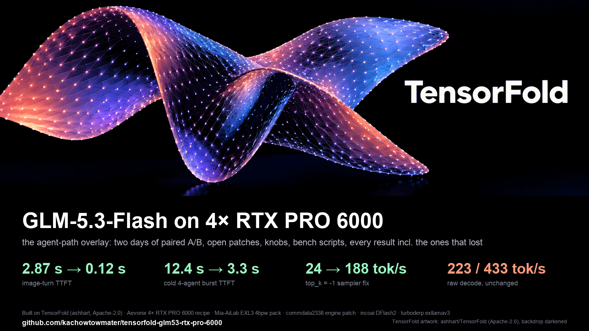
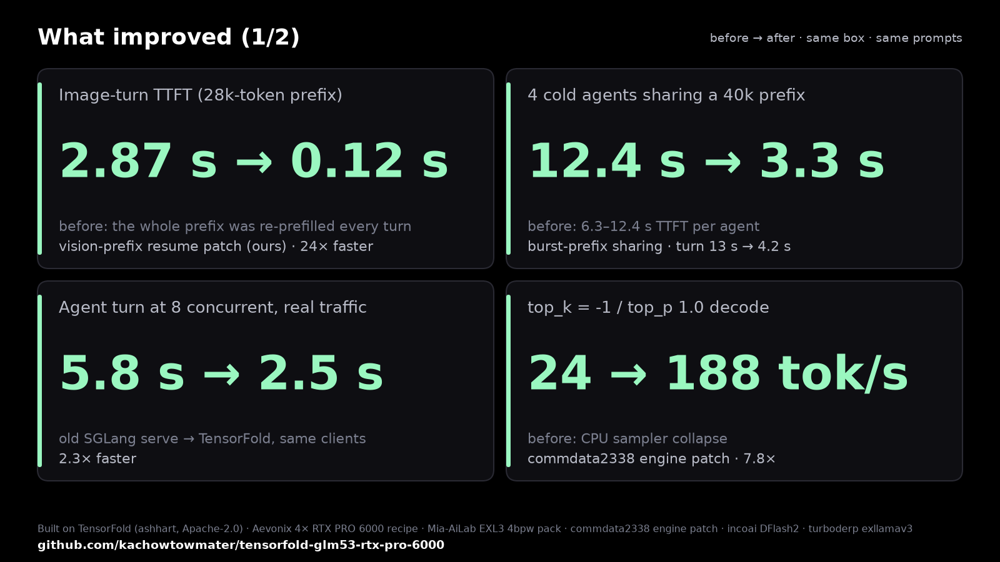
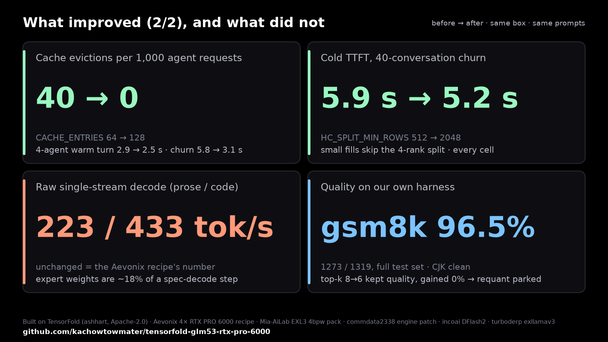

# GLM-5.3-Flash on TensorFold, 4× RTX PRO 6000: the agent-path overlay

Ten custom TensorFold patches (plus three more that need the optional 0900 engine patch, in `patches/needs-0900/`), a tuned knob file, the measurement scripts, and every result (including the ones that lost) from paired A/B on one box: 4× NVIDIA RTX PRO 6000 Blackwell Max-Q (96 GB each, PCIe, 250 W cap), TensorFold v0.6.5 with the Aevonix 86-patch recipe, Mia-AiLab's EXL3 4-bpw pack, the DFlash2 drafter. Current release: **x25** (image `tensorfold-glm53:1.1.0-x25`), which adds x15 prefill fairness, x16 selection/cache/name-priority patches, x17 background-class routing, x18/x25 prompt-cache tiers with write-behind parking, x21/x23 scheduler fixes and the x24 fused selection kernel to x14.

## What you gain

If you run coding agents (long prompts, tool calls, images, several at once) against this serve, this is the difference, measured on the same box with the same prompts, before → after. The first three rows are new in x14 and compare against x9 in the same window (unique prompts, temperature 0); the rows after them are new in x15–x25 and compare against the prior release in the same window; the rest compare x9 against the recipe defaults or our old serve:

| what | before | after | how much | where it comes from |
|---|---|---|---|---|
| Decode of a short request while a 400k-token cached session sends a request every 1 s (85 tokens out) | 117.9 tok/s | **151.0 tok/s** | **+28%** | patches 0921 + 0923: the long session's prompt no longer holds the GIL while it is tokenized, so the engine loop stops stalling once a second |
| Tokenize a 400k-token prompt | 707–855 ms (HF tokenizers) | **41–44 ms**, GIL released | **16–21× faster** | patch 0923 (fastokens 0.3.2, `TF_W1_FASTOKENS=1`); token ids identical to HF tokenizers over 5,857,088 tokens |
| Throughput at C1 code / prose / JSON, C8, C32 (tok/s) | 341.1 / 186.1 / 419.2, 695.6, 1123.5 | 339.7 / 186.8 / 416.8, 705.7, 1132.6 | unchanged (within noise) | x14 changes tokenization only |
| Time to first token on an image turn (28k-token conversation with a picture; turns 2 and 3) | 2.87 s, every turn | **0.12 s** | **24× faster** | patch 0910: the text prefix stays cached instead of being re-prefilled |
| Prefill seconds burned by image turns on a day of agent traffic | 80% of all prefill time | ~0 | | same patch (632 of 4,365 requests were doing this) |
| 4 cold agents starting on the same 40k-token repo | TTFT 6.3–12.4 s each, turn ~13 s | **3.3 s each, turn 4.2 s** | **3× faster** | burst-prefix sharing (commdata2338's engine patch, optional) |
| Decode when a client sends `top_k=-1` / `top_p 1.0` | 24 tok/s (CPU sampler collapse) | **188 tok/s** | **7.8×** | same patch |
| Agent turn time at 8 concurrent agents, real traffic | 5.8 s on our old SGLang serve | **2.5 s** | **2.3× faster** | TensorFold + this recipe |
| Kept-state cache evictions per ~1,000 agent requests | 40 | **0** | | `TF_GLM_CACHE_ENTRIES` 64 → 128 |
| 4-agent warm turn / TTFT p90 / churn warm turn | 2.9 s / 0.98 s / 5.8 s (recipe defaults) | **2.5 s / 0.51 s / 3.1 s** | 14–47% | window, graph step, prefill rows, cache knobs |
| Cold TTFT under 40-conversation churn | 5.9 s | **5.2 s** | 12% | `TF_GLM_HC_SPLIT_MIN_ROWS` 512 → 2048 (small fills skip the 4-rank split) |
| Quality (gsm8k full test set, our harness) | 96.5% | 96.5% | unchanged | nothing here touches the weights |
| Long-context correctness on x14 | | recall 8/8 at 326k (28,500-record ledger), no repetition at 400k and 320k, 8,192-token output clean, tool call + needle at 300k pass | | |
| Other requests' decode while one client prefills 32k / 128k / 400k tokens (x15) | stalled to ~0.15 of wall time | decode keeps ≥ 0.5 of wall time | **6.6× / 15× / 13× faster** | `TF_GLM_FILL_CREDIT=time TF_GLM_FILL_SHARE=0.5`: the scheduler credits prefill by elapsed time, not by iteration count; the long prompt's own fill is 1.8–2.2× slower |
| Foreground TTFT while a background loop runs on its own served id (x17) | 86 ms median, 177 ms max | **46 ms median, 53 ms max** | −47% median | `TENSORFOLD_NAME_PRIORITY="id=background"` (patch 0933): a second served id defaults to the background class, so its rounds yield first |
| An evicted session comes back (x18) | 45 s (400k) / 142 s (1M) cold re-prefill | **2.6 s / 9.2 s**, identical text, survives a restart | 17× / 15× | patches 0940 + 0941 (0941 needs the optional 0900 engine patch): evicted prompts park to host RAM then NVMe; a returning session restores its parked state (`TF_GLM_MULTI_PARK=1`, `TF_GLM_DISK_CACHE`, `xxhash==3.5.0` for the piece checksums) |
| Foreground decode while a background 400k prompt loads (x21) | ~11 chunks/s | **~48 chunks/s**, p999 decode gap 1.11 → 0.59 s, short TTFT p90 0.98 → 0.62 s | 4.4× | patch 0970 (needs the optional 0900 engine patch): cross-class time credit — the filling side pays its wall-clock share between classes |
| Decode freezes >1 s while a background prompt prefills (x23) | 5–12 per run | **0**, short-request TTFT median 0.54 → 0.05 s | eliminated | patch 0972: a foreground-led prefill chunk no longer packs rows from a later priority class |
| Token selection per decode round (x24) | 5 kernel launches | **1 fused kernel** | **11–37× faster per round**, 400k-context decode 195 → 227 tok/s (+16%), bit-exact (92/92 GPU checks) | patch 0980 (`TF_GLM_TOPK_V2=1`): SGLang's DeepSeek-v4 topk_v2 radix select ported to the recipe's order-key selection |
| Worst decode gap when 9 × 400k parked prompts overflow the KV pool (x25) | 2.05–2.19 s, gap p99 0.43 s | **0.86–1.18 s, gap p99 0.09 s**, restores identical | ~2× shorter, p99 4.8× | patch 0990 (`TF_GLM_PARK_ASYNC=1`, needs the optional 0900 engine patch): park copies into a preallocated pinned staging extent and writes NVMe from a background thread |
| Throughput at C1 / C32 after all of the above | ~335 / ~1120 tok/s | unchanged | | the fairness, tiering and parking changes trade long-prompt load time for everyone else's latency, not throughput |

What you do **not** gain: raw single-stream decode. It stays at the Aevonix recipe's number (223 tok/s prose, 433 code, greedy, server-side). We measured why rather than guessing: under speculative decoding each MoE layer touches ~60 distinct experts per step whatever you do to the weights, so expert bytes are ~18% of a step; cutting them 25% (top-k 8 → 6) kept quality and changed speed 0%. That is why the requant is parked. x14 does not change it either (C1 within ±0.6% of x9). Details and every table: [docs/RETROSPECTIVE.md](docs/RETROSPECTIVE.md); x14 numbers: `results/x14-vs-x9-2026-10-13.json`.

The x15–x25 rows trade latency for latency, and the trade-offs are measured too: a background-class 400k prompt loads slower under contention (51 → ~170 s — fairness means it waits its turn), and under pool overflow the worst short-request TTFT rose 0.52 → 1.09 s on one request (p90 unchanged at ~0.10 s in a same-session compare). Everything is flag-gated: leave `TF_GLM_FILL_CREDIT`, `TENSORFOLD_NAME_PRIORITY`, `TF_GLM_MULTI_PARK`, `TF_GLM_TOPK_V2` and `TF_GLM_PARK_ASYNC` unset for the x14 behaviour. Three of these rows (the evicted-session restore, the cross-class credit, write-behind park) need the optional 0900 engine patch — without it those knobs stay off, the rest of the overlay builds and runs unchanged.





## What is in here

| path | what | status |
|---|---|---|
| `patches/0910-vision-prefix-resume.patch` | image prompts keep and resume their text prefix in the kept-state cache instead of re-prefilling the whole conversation every turn. 3-turn image conversation, 28k prefix: turn-2/3 TTFT **2.87 s → 0.12 s** (27,968 of 28,058 tokens cached), replies and greedy probes identical. Flag `TF_GLM_VISION_PREFIX=1`. | in production |
| `patches/0921-tokenize-no-gil.patch` | port of MiaAI-Lab patch 0099: prompts are tokenized through HF tokenizers' batch calls, which release the GIL (`encode` holds it ~1.2 µs a token). `App._encode_ids` at four server sites (prepare, `_encode` fallback, think-close, tool gate), `encode_batch_fast` / `encode_batch` in the incremental tokenizer, and `vision/glm.py`. Same ids. | in production (x14) |
| `patches/0923-fastokens-flag.patch` | prompt encoding through fastokens 0.3.2 (Rust, GIL released, multi-threaded) behind `TF_W1_FASTOKENS=1`: new `tensorfold/cuda/fasttok.py`, used by `App._encode_ids`, the incremental tokenizer's tail (literal barriers found in the text; on any disagreement with the special-token boundaries it falls back to the HF offsets path) and `vision/glm.py`. Applies after 0921. Off = x9 + 0921 exactly. Needs `fastokens==0.3.2` in the image (the installer adds it). | in production (x14) |
| `patches/0930-glm-select-onepass.patch` | one pass over the scores for a prompt chunk's top-512 pools (was two) behind `TF_GLM_SEL_ONEPASS=1`. Verified idle: the two-pass path was already fast enough on the boxes we measured. | verified, idle |
| `patches/0932-glm-kept-entries-share.patch` | `TF_GLM_CACHE_SHARE_PCT`: the kept prompt-state count can follow a share of the KV pool's memory (default 0 = off, x15 behaviour exactly) so a pool of millions of free tokens is not pushed empty by 32 one-shot conversations. Past three quarters of the budget the count is cut. | verified, idle |
| `patches/0933-glm-name-priority.patch` | `--name-priority "id=class"` (repeatable): a second served id whose requests default to the background class, so a heavy client on its own id yields to everyone else. Foreground TTFT behind that loop 86 → 46 ms median. | in production (x17) |
| `patches/0940-glm-pcache-tiers.patch` | the prompt-cache tiers' CPU part (ported from MiaAI-Lab 0132 + Aevonix 260–266, see PINS.md): new `pcache.py` (page-aligned file format, xxh3_64 per-piece checksums, identity-checked on every read) and `host_tier.py` (pinned-host RAM tier). Flags `TF_GLM_MULTI_PARK`, `TF_GLM_DISK_CACHE` (default off = x16 exactly). | in production (x18) |
| `patches/needs-0900/0941-glm-pcache-park-restore.patch` | wires the tiers into the engine: evicted prompts park to RAM then NVMe, a returning session restores its parked state (rank 0 decides, every rank must agree via a min all-reduce or everyone cold-prefills). Evicted-session restore 400k 45 s → 2.6 s, 1M 142 s → 9.2 s. | needs the optional 0900 engine patch |
| `patches/needs-0900/0970-glm-cross-class-time-credit.patch` | with `TF_GLM_FILL_CREDIT=time` (0900's existing flag), the credit is now keyed by (fill class, round class) and uses each side's wall-clock share between different classes, so a filling background prompt can no longer starve foreground decode by iteration count. Foreground decode behind a 400k fill ~11 → ~48 chunks/s. No new flag, no new default. | needs the optional 0900 engine patch |
| `patches/0972-glm-group-no-later-class.patch` | a multi-prefill chunk led by a normal (or sooner) lane no longer packs rows from lanes of a later priority class, so a short foreground prompt's chunk cannot carry background rows. Decode freezes >1 s during background prefill 5–12 → 0 per run. No new flag. | in production (x23) |
| `patches/0980-glm-topk-v2.patch` | the segmented decode selection (five launches) through one fused CUDA kernel behind `TF_GLM_TOPK_V2=1` (off = x23 exactly, byte-identical): SGLang's DeepSeek-v4 topk_v2 single-block radix select (Apache-2.0, commit `5b12ec1`; itself from vLLM's persistent_topk and flashinfer's topk) ported to the recipe's order-key selection. Bit-exact 92/92 GPU checks; 400k-context decode +16%. | in production (x24) |
| `patches/needs-0900/0990-glm-park-async.patch` | write-behind parking behind `TF_GLM_PARK_ASYNC=1` (off = synchronous park exactly): park copies sections into a preallocated pinned staging extent (D2H synced before return), publishes the RAM copy at once, and the checksums, header, fsync and rename move to a background writer thread. Pool-overflow worst decode gap 2.05–2.19 → 0.86–1.18 s. | needs the optional 0900 engine patch |
| `patches/0909-mixed-bits.patch` | lets TF load EXL3 packs whose routed experts have different bit widths per tensor (3/4/5) and makes the autotuner tune every width present. On a normal 4-bit pack it is a verified no-op (probes and tok/s identical). Needed only if you requantize with exllamav3's per-tensor recipe. | verified, idle |
| `patches/variants/0910-…x1.patch` | the same vision-prefix patch for trees that also carry commdata2338's engine patch (see PINS.md) | in production on our box |
| `patches/needs-0900/` | the three patches above that edit 0900's code, with a README naming what each needs; `install-overlay.sh` applies them (in order, after 0900) only when it finds `0900-commdata-engine.patch` in the recipe | needs the optional 0900 engine patch |
| `scripts/local.sh` | the tuned knobs with the measurement that justified each one (see below) | in production |
| `scripts/install-overlay.sh` | puts the patches and knobs onto a clean Aevonix recipe checkout, sets the image tag `1.1.0-x25` and adds `fastokens==0.3.2` and `xxhash==3.5.0` to `IMAGE_EXTRAS` | tested on a clean checkout (96 patches apply, fuzz 0; 99 with 0900 dropped in) and as an upgrade over an x9/x14 install |
| `bench/` | `tfprobe2.py` (4 fixed greedy probes, server-side tok/s + accepted/drafted), `quietprobe.sh` (runs them only when the server is idle), `agentsim.py` (4 agents × 6 turns on ~58k-token repos + 40-conversation churn), `cjk_canary.py` (20 Chinese prompts, counts U+FFFD), `visionprobe.py` (3-turn image conversation), `tok_check_x14.py` (x14 token-identity gate: fastokens vs HF tokenizers, id for id, plus the incremental tokenizer cold and warm) and `tok_check_mutation.py` (breaks 0923 two ways; the gate must go red) | what every number here was measured with |
| `results/` | `x14-vs-x9-2026-10-13.json` (the x14 A/B), `tok-check-x14-2026-10-13.log` (identity gate: 0 mismatches over 5,857,088 tokens; mutation runs A and B red), `baseline-x9-2026-10-07.json` (the full measured x9 baseline with every command), the graphics (`cover-black.png`, `cards-1-black.png`, `cards-2-black.png`, stacked `results-black.png`) and `make_chart.py` | |
| `rejected/` | four patches of ours that lost and the knob sweeps and rebases that lost, with their numbers | kept on purpose |
| `docs/` | the retrospective and the dry-run window log | |
| `PINS.md` | every upstream this sits on, with sha and licence | |

## The knobs (`scripts/local.sh`), each with the paired measurement

| knob | value | measured (same box, same prompts, paired against the recipe default) |
|---|---|---|
| `TF_GLM_MULTI_WINDOW` / `TF_GLM_MULTI_GRAPH_STEP` | 64 / 4 | with the three below: 4-agent warm turn 2.9 → 2.7 s, TTFT p90 0.98 → 0.52 s, churn cold turn 12.2 → 8.6 s |
| `TF_GLM_PREFILL_ROWS` + `TF_GLM_CE_ARENA_MIB` | 8192 + 320 | prefill chunks of 8192 rows (autotune the 4097–8192 bucket: 11 shapes +8.6…+23.5%) |
| `TF_GLM_FILL_ROWS` | 4096 | part of the same round |
| `TF_GLM_CACHE_ENTRIES` | 128 | 4-agent warm turn 2.5 s / p90 3.5, churn warm turn 5.8 → 3.1 s; at 128: 0 evictions in 1,077 agent requests vs 40 before |
| `TF_GLM_HC_SPLIT_MIN_ROWS` | 2048 (default 512) | small warm-turn fills (~1k rows) skip the 4-rank hyper-connection split: churn cold TTFT 5.9 → 5.2 s, consistent on every cell across two runs, probes identical |
| `TF_GLM_VISION_PREFIX` | 1 | needs patch 0910; numbers above |
| `TF_W1_FASTOKENS` | 1 | needs patches 0921 + 0923 and `fastokens==0.3.2`; long-session co-run short decode 117.9 → 151.0 tok/s, 400k-token tokenize 707–855 → 41–44 ms, C1/C8/C32 unchanged |
| `TF_GLM_FILL_CREDIT=time` + `TF_GLM_FILL_SHARE` | time / 0.5 | x15: other requests' decode during a 32k/128k/400k prefill 6.6×/15×/13× faster; the long prompt's own fill 1.8–2.2× slower. With patch 0970 (needs the optional 0900 engine patch) the credit also works between priority classes (x21) |
| `TENSORFOLD_NAME_PRIORITY` | `id=background` | x17 (patch 0933): foreground TTFT behind the background loop 86 → 46 ms median, 177 → 53 ms max; foreground decode −5%. Unset = one class |
| `TF_GLM_MULTI_PARK` + `TF_GLM_DISK_CACHE` (+`_GIB` 96, `TF_GLM_HOST_CACHE_GIB` 40) | 1 / `/cache/pcache` | x18 (patches 0940 + 0941; 0941 needs the optional 0900 engine patch): evicted-session restore 400k 45 s → 2.6 s, 1M 142 s → 9.2 s, identical text, survives a restart; budgets are per rank |
| `TF_GLM_TOPK_V2` | 1 | x24 (patch 0980): selection per decode round 11–37× faster, 400k-context decode 195 → 227 tok/s (+16%), bit-exact (92/92 GPU checks); 0 = x23 path byte-identical |
| `TF_GLM_PARK_ASYNC` | 1 | x25 (patch 0990; needs the optional 0900 engine patch): park stops freezing decode — pool-overflow worst decode gap 2.05–2.19 → 0.86–1.18 s, gap p99 0.43 → 0.09 s; unset = synchronous park |
| `TENSORFOLD_GPU_SAMPLE_FULL`, `TENSORFOLD_SAMPLE_SKIP_FUTILE`, `TF_GLM_BURST_PREFIX`, `TF_GLM_CACHE_REASONS` | 1 | **only with commdata2338's engine patch** (optional, see PINS.md): explicit `top_k=-1` / `top_p 1.0` decode 24 → 188 tok/s; 4 cold agents sharing a 40k prefix: TTFT 6.3–12.4 s → 3.3 s each, turn ~13 s → 4.2 s. Without that patch these variables are ignored |

Power cap stays at 250 W (settled earlier: 400 W made decode slightly worse on these cards).

## Setup (one evening, assuming the hardware)

Hardware: 4× RTX PRO 6000 Blackwell (96 GB each; ours are Max-Q), PCIe host with CUDA peer access between every pair (`nvidia-smi topo -p2p r` all OK), ~400 GB of free disk for the pack, Docker with the NVIDIA runtime. Everything runs inside the recipe's container.

```bash
# 1. the Aevonix recipe at the pinned commit
# (upstream main is now release 1.2.0; the 1.1.0 pin is off-branch, so fetch it by sha)
git clone https://github.com/Aevonix/GLM-5.3-Flash-EXL3-4x-RTX-PRO-6000-TensorFold recipe
cd recipe && git fetch origin a19078566298f8c51d9dbb317f20efd51fe564df && git checkout a19078566298f8c51d9dbb317f20efd51fe564df && cd ..

# 2. this overlay onto it (copies 10 patches into patches/extra/, fixes the strict patch count to 96, installs the knobs,
#    image tag 1.1.0-x25, adds fastokens==0.3.2 and xxhash==3.5.0 to IMAGE_EXTRAS; with the optional 0900 engine patch
#    dropped in first, it also applies the 3 patches/needs-0900/ patches and recounts to 99)
git clone https://github.com/kachowtowmater/tensorfold-glm53-rtx-pro-6000 overlay
./overlay/scripts/install-overlay.sh "$PWD/recipe"

# 3. build the image: clones TensorFold v0.6.5, applies 86 + 10 patches (99 with the optional 0900 engine patch), installs the runtime (first build ~20-40 min)
cd recipe && ./scripts/prepare.sh        # downloads Mia's pack (164 GB) + DFlash2 if missing; DRY_RUN=1 ./scripts/prepare.sh to see the plan

# 4. serve (first start compiles the CUDA kernels and autotunes, ~10 min; cached afterwards)
./start.sh                                # model id glm-5.3-flash-rtx on :8090 (PORT= and SERVED_NAME= in scripts/local.sh)
curl -s localhost:8090/v1/models

# 5. measure what you got (server-side numbers come from the TF log, not the client)
PORT=8090 LOG=$PWD/logs/current/rank0.log ../overlay/bench/quietprobe.sh      # 4 probes: tok/s + accepted/drafted
python3 ../overlay/bench/agentsim.py 4 6 30000 40                               # 4 agents x 6 turns + 40-conversation churn
python3 ../overlay/bench/cjk_canary.py                                          # expect 0 mid-text U+FFFD
./stop.sh
```

Expected on our box after step 5: probes `222/330 329/392 310/367 242/424` accepted/drafted at `223 / 433 / 383 / 235` tok/s; agentsim 4-agent warm turn ~2.9 s (p90 3.8), churn warm turn ~5.5 s; agentsim cells repeat within ±10–15%, probes within ±2%. Full baseline: `results/baseline-x9-2026-10-07.json`. x14 leaves these numbers where they are; it changes what happens when one client sends very long prompts while others decode (`results/x14-vs-x9-2026-10-13.json`). To check the tokenizer on your own texts: `python3 bench/tok_check_x14.py <model_dir> <corpus_dir> [requests.jsonl ...]` inside the image (it expects `long-400k.txt`, `needle-300k.txt` and `pg*.txt` books in the corpus dir).

Optional, for the sampler fix and burst-prefix sharing (and the three patches above that build on it): fetch commdata2338's engine patch (PINS.md), drop it in `recipe/patches/extra/0900-commdata-engine.patch`, replace `0910-…` with `patches/variants/0910-…x1.patch`, rerun `install-overlay.sh` — it copies the `patches/needs-0900/` set in after 0900 and recounts (86 + 10 base + 0900 + 3 = 100 files, one of them replacing 0910, so the build applies 99) — and rebuild. We run that in production; we do not redistribute their patch because it carries no licence.

Upgrading an x9/x14 install: rerun `install-overlay.sh` on the same recipe checkout. It copies the new patches, recounts to 96 (99 when 0900 is present and the needs-0900 set applies), switches the tag and `IMAGE_EXTRAS`, and appends any knob line your `scripts/local.sh` lacks (x15 fairness, the prompt-cache tiers, `TF_GLM_TOPK_V2`, `TF_GLM_PARK_ASYNC`). Then rebuild with `./scripts/prepare.sh`.

## What did not work (short version; numbers in `rejected/README.md`)

Decode-wait yields, PDL on the EXL3 decode kernel, two mixed chunk+decode schedulers, Mia's sliced fill, CUDA-IPC comms, deeper or cost-measured draft depth, bf16 KV, bigger prefill rows, more parallel streams. Top-k 8 → 6 kept quality (gsm8k 96.0 vs 95.7 on a paired 300-item subset) and changed speed 0%, which is the measurement that tells you expert bytes are not the bottleneck under speculative decoding and parked our requant plan. This week (x14): the Aevonix 1.2.0 rebase (its `MULTI_WINDOW 128` / `GRAPH_STEP 8` defaults cost the long-session co-run 24%), `MULTI_WINDOW 32` (C32 −14%), fill/prefill row and `COPY_MAX` variants (noise), indexer grid 512 + TF PR #421 (no gain on a quiet serve). Since then (x15–x25, tables in `rejected/README.md`): the x16 selection/cache-count variants that did not move the numbers (select one-pass stayed idle, verbatim conversation history no gain on TensorFold, HTTP 429 stream rejection converts queueing into errors), `FILL_ROWS` 2048/1024 (+15%/+85% long-prompt TTFT), a GVR top-k port (−9% C1, −11% 400k decode), IndexShare (lossy on Flash), forcing P2P (peer-to-peer already runs 54 GB/s), and a mixed decode+prefill forward pass (exactness forces dual kernel routes — NO-GO). And one method lesson: other users' traffic on the box during an A/B produced fake 1.2–1.9× wins; block it for the window. What we did not get to: a step-time breakdown of the other ~82% (TP4 all-reduce over PCIe and ungraphed 9-token verify steps are the suspects). If you do it first, open an issue.

## Credits

- **TensorFold** by [ashhart](https://github.com/ashhart/TensorFold) (Apache-2.0): the engine, EXL3 expert kernels, DSA/KDA attention, CUDA graphs, drafter verification. Everything here is a patch on top of it.
- **Aevonix**: the [4× RTX PRO 6000 recipe](https://github.com/Aevonix/GLM-5.3-Flash-EXL3-4x-RTX-PRO-6000-TensorFold) (TP4, FP8 KV, 1M window, 86 patches with Mia-AiLab) and the published baseline we measured against.
- **Mia-AiLab** (MiaAI-Lab): the EXL3 4-bpw pack, the original DGX Spark patch series, and patch 0099 (tokenize without the GIL), which our 0921 ports.
- **commdata2338**: the engine patch that fixes the sampler collapse and adds burst-prefix sharing and cache-reason logging, plus the independent 4× PRO 6000 benchmark.
- **crusoecloud**: [fastokens](https://github.com/crusoecloud/fastokens) (Apache-2.0), the Rust tokenizer patch 0923 encodes prompts with.
- **incoai**: the DFlash2 drafter weights. **turboderp**: exllamav3 and the EXL3 format.
- Artwork: the TensorFold hero image is the project's own (`assets/tensorfold-hero.png` in ashhart/TensorFold, Apache-2.0); we only darkened its navy backdrop to black (`results/make_chart.py`, original kept in `results/assets/`). The results card is ours.
- Measured and written by kachowtowmater's agent fleet (Claude Code orchestrating omp/GLM workers), Oct 5–7 2026; x14 on Oct 13 2026; x25 on Oct 16 2026.

Licence: Apache-2.0 for the files in this repo (patches are derivatives of TensorFold, same licence). Weights and upstream patches are not included; see PINS.md.
